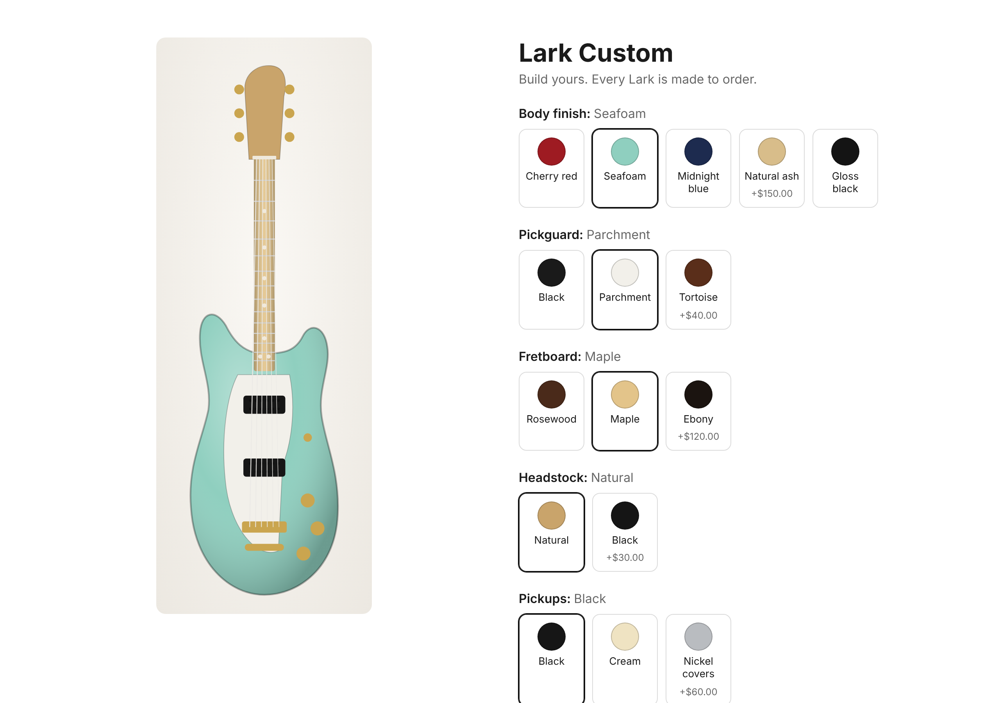

# Lark Guitars – Custom Guitar Configurator (Shopify)

A "build your own" page like Sweetwater's Mesa/Boogie custom amp configurator:
customers pick options, see a live preview and running price, then add the build to the cart.

- `demo/index.html` – standalone demo with sample options (open in a browser, no Shopify needed)
- `shopify/sections/guitar-configurator.liquid` – the theme section
- `shopify/assets/guitar-configurator.js` – preview, pricing, cart logic
- `shopify/assets/guitar-configurator.css` – styles

## Install

1. **Back up your theme:** Online Store → Themes → ⋯ → Duplicate. Work on the copy.
2. ⋯ → **Edit code**:
   - In **sections/**, add a new section `guitar-configurator` and paste in the `.liquid` file.
   - In **assets/**, add `guitar-configurator.js` and `guitar-configurator.css` and paste in their contents.
3. **Create the base product**, e.g. "Lark Custom" at $1,899.
4. **Create upcharge products** for options that cost extra, e.g. "Upcharge – Ebony fretboard" at $120.
   Set them to *Unlisted*/hidden from search and collections, and don't track inventory.
5. **Make a page template:** Online Store → Themes → Customize → Pages → create template `custom-build`.
   Add the **Guitar configurator** section and pick the base product.
6. **Add options:** each block in the section is one choice. Set its *Option group* (choices with the
   same group show together), *Choice name*, the *Part* it changes, a *Colour*, and an
   *Upcharge product* if it costs extra. Tick *Selected by default* on one choice per group.
7. Create a page (e.g. `/pages/custom-shop`) using the `custom-build` template and link it in your menu.

## Using real photos instead of the drawing

The demo draws a placeholder guitar and recolours it. For a realistic look like Sweetwater's:

1. Photograph (or render) the guitar **from one fixed angle**, same canvas size for every image.
2. Make a **base photo** (background/shadow) and a **transparent PNG for each part in each option**,
   e.g. body in each finish, each pickguard, each hardware colour. Each PNG should show only that part.
3. Set *Base photo* on the section and *Preview layer image* on each choice. The layers stack
   in the order body → pickguard → fretboard → headstock → pickups → hardware.
4. Optional: add a *Swatch image* (wood grain, burst) to show instead of a colour dot.

## How the cart works

"Add build to cart" adds the base product, plus one upcharge product per paid option.
They share a **Build ID**, and every choice is saved on the order as a line-item property,
so the order shows exactly what to build. "Share build" copies a link that reopens the same build.

**Limitation:** a customer could remove an upcharge line from the cart. Check that the Build ID
lines match when you fulfil. To lock them together, use Shopify's bundle / Cart Transform
features or a product-options app.

**Taking deposits instead:** if you'd rather take a deposit or quote than the full price,
point the base product at a "Deposit" product. The chosen options still come through on the order.
